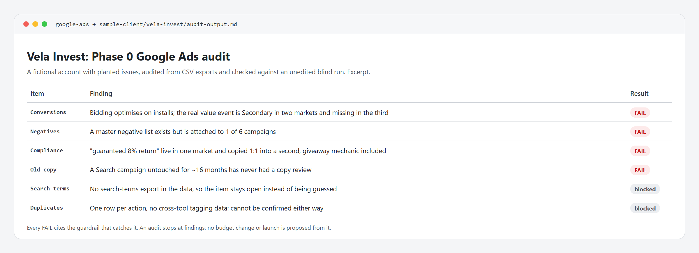

# Paid Ads Agent Playbook

Two Claude Code subagents that run Google Ads and Meta (Facebook/Instagram) Ads
accounts by a fixed process instead of ad-hoc clicking: audit, account setup,
campaign structure, creative specs, QA, launch and ongoing optimization, across
several markets and legal entities.

- **[`google-ads`](.claude/agents/google-ads.md) and [`facebook-ads`](.claude/agents/facebook-ads.md)**: drop-in agent files. Audit-only by default (`Read, Grep, Glob`).
- **[The playbook](paid-ads-agent-playbook.md)**: the full ruleset both agents point to. Every guardrail is a mistake that actually happened once (a placeholder budget used for real, a banned claim copied into a second market, a local-language token in an English naming scheme).
- **[`ads-ops/`](ads-ops/README.md)**: what makes the agents safe to run every week. A cadence with overdue reminders, a change ledger that refuses a live change without the old value, an approval and a rollback trigger, automatic versions of the agent files, and a language gate for ad copy that fails closed.
- **[A worked example](sample-client/vela-invest/audit-output.md)** with its evidence: a fictional account with seven planted issues, the audit, and the [unedited blind run](sample-client/vela-invest/blind-run-2026-10-13.md) it was checked against.

It is extracted from a real production setup and anonymized: company names,
account IDs, internal links and people's names are removed or replaced with
placeholders.

## Try it in five minutes

1. Copy `.claude/agents/google-ads.md` into your own project's `.claude/agents/`.
   No editing needed to try it; the placeholders only matter once you point it at
   your own account.
2. Ask: "audit the Google Ads account in `sample-client/vela-invest/data/`".
3. Compare with [`audit-output.md`](sample-client/vela-invest/audit-output.md). Each
   finding cites the rule that catches it, and the
   [blind run](sample-client/vela-invest/blind-run-2026-10-13.md) shows what a fresh
   agent with only the agent file and the CSVs found, including where it disagreed
   and why.

## What is in the repo

| Path | What |
|---|---|
| [`paid-ads-agent-playbook.md`](paid-ads-agent-playbook.md) | Shared conventions (entities, naming, starter pack, measurement, creative production, event priority, guardrails, budget rules), then Phase 0-7 for each platform, the learning loop and the ops layer |
| [`.claude/agents/`](.claude/agents/) | The two subagents: operating summary, guardrails, Phase 0 audit checklist, output format |
| [`.claude/skills/ads-research-scan/`](.claude/skills/ads-research-scan/SKILL.md) | Monthly scan of changelogs, practitioner sources and GitHub, logged as hypotheses, never installed on the spot |
| [`ads-ops/`](ads-ops/README.md) | `cadence.json`, `goals.md`, change ledger, watchlist, learnings, `ads_ops.py`, `langcheck_ads.py`, hook config |
| [`sample-client/vela-invest/`](sample-client/vela-invest/README.md) | Fictional account as CSV exports, the audit, the blind run |
| [`tests/`](tests/) | 41 standard-library tests for both scripts and for repo integrity (links, agent frontmatter, sample data vs. audit), run on Linux, macOS and Windows by [CI](.github/workflows/tests.yml) |

## Using it for real

1. Read [`paid-ads-agent-playbook.md`](paid-ads-agent-playbook.md).
2. Replace `[Product]`, `[Company]`, `[Market A/B/C]` and the entity/account tables
   with your own, and point the "source of truth" bullets at wherever you keep
   campaign plans, tone of voice and naming.
3. Copy both agent files into your project. For live work, add your browser tools
   (and `Bash` for the ads-ops scripts) to `tools:` in your copy.
4. Keep the guardrails and phase checklists; delete what doesn't apply (one market
   = no multi-entity billing rules).
5. Optional: copy `ads-ops/` next to `.claude/` and merge its hooks (below).

## Running it on a schedule, safely

- `cadence.json` + a `SessionStart` hook: weekly checks, monthly audits of each
  account and of measurement, a monthly research scan, a quarterly access audit.
  The session lists what is overdue and offers it; nothing live runs on its own.
- `goals.md`: goals, budget ceilings and the optimisation target, confirmed by the
  owner and stale after 30 days, so the agents ask instead of guessing.
- `ads_ops.py ledger`: every live change is written down first with the old value,
  the approval and a rollback trigger; `ledger rollback <id>` prints the way back.
- A `PreToolUse` hook versions every agent, skill and goals file before each edit,
  restorable with `ads_ops.py restore`.
- `langcheck_ads.py`: Hunspell + LanguageTool (+ Korektor for Czech) before any ad
  copy is uploaded. Exit 1 on findings, exit 3 when no checker was available, so a
  missing dictionary never passes as "clean".

## Requirements

Claude Code for the agents. Python 3.9+ for the scripts, standard library only;
the language check optionally uses `spylls`, LibreOffice dictionaries and a local
LanguageTool server. Commands are written as `python`; use `python3` where that is
the name on your system (macOS, most Linux). Run the tests with
`python -m unittest discover -s tests`.

## License

MIT, see [LICENSE](LICENSE).
